# Лабораторная работа №3: Шаблоны. Админка Django

**Студент:** Ануфриев Владислав Денисович  
**Группа:** ПИЖ-б-о-25-2  
**Технология:** Python + Django  
**Вариант:** 2

---

## Цель работы

Изучить шаблоны Django и механизм рендеринга, освоить работу со встроенной административной панелью Django. Научиться выводить данные из модели в браузер через шаблоны, использовать директивы, теги и фильтры шаблонизатора, а также настраивать отображение моделей в админке.

---

## Ход работы

### 1. Создание модели News

В файле `news/models.py` создана модель `News` с полями: наименование, контент, дата публикации, дата обновления, фото, статус публикации. Также добавлен подкласс `Meta` с русскими названиями модели и сортировкой по убыванию даты создания.

**Скриншот 1 — `models.py` с классом `News`:**

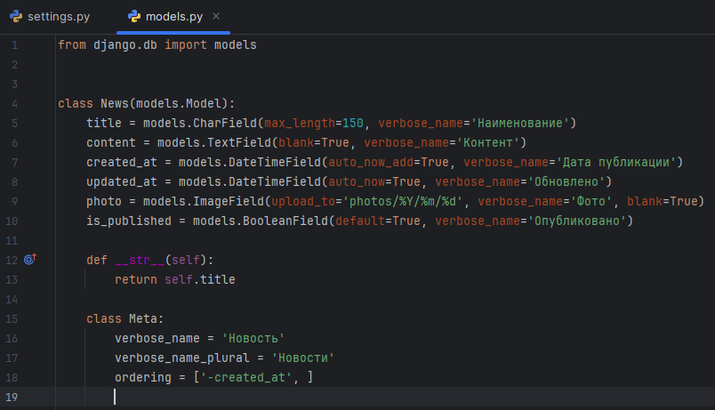

---

### 2. Применение миграций

Выполнены команды `makemigrations` и `migrate` для создания таблицы `News` в базе данных.

**Скриншот 2 — терминал с результатом миграций:**

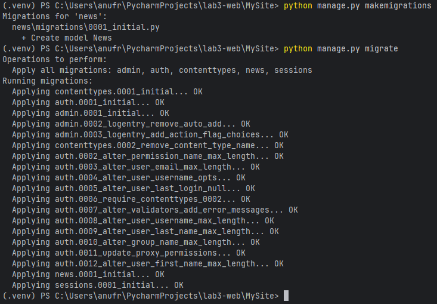

---

### 3. Создание суперпользователя

Выполнена команда `createsuperuser` для создания учётной записи администратора.

**Скриншот 3 — терминал с сообщением `Superuser created successfully`:**

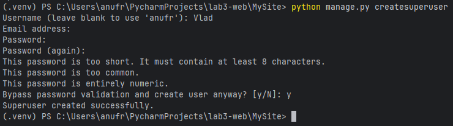

---

### 4. Регистрация модели в админке

В файле `news/admin.py` создан класс `NewsAdmin`, настроены отображаемые поля (`list_display`), кликабельные поля (`list_display_links`) и поля поиска (`search_fields`). Модель зарегистрирована через `admin.site.register(News, NewsAdmin)`.

**Скриншот 4 — `admin.py` с классом `NewsAdmin`:**

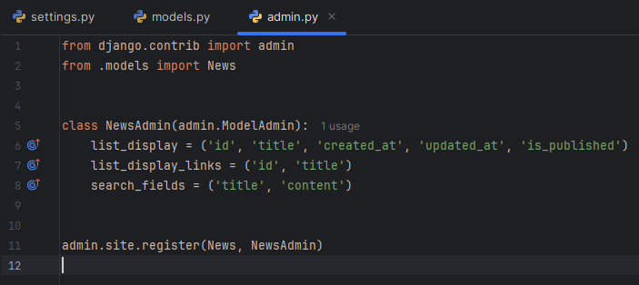

---

### 5. Проверка админки

После запуска сервера и входа в админку по адресу `http://127.0.0.1:8000/admin` появился раздел «NEWS».

**Скриншот 5 — главная страница админки с разделом «NEWS»:**

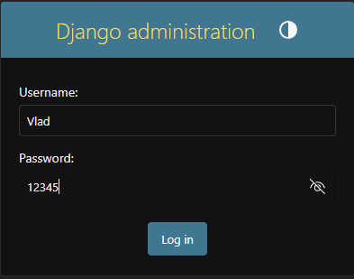

---

### 6. Добавление новостей через админку

Через админку добавлены 4 тестовые новости.

**Скриншот 6 — список новостей в админке (до добавления):**

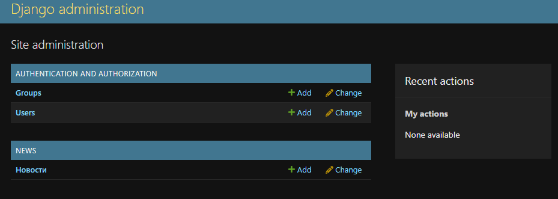

**Скриншот 7 — список 4 добавленных новостей:**

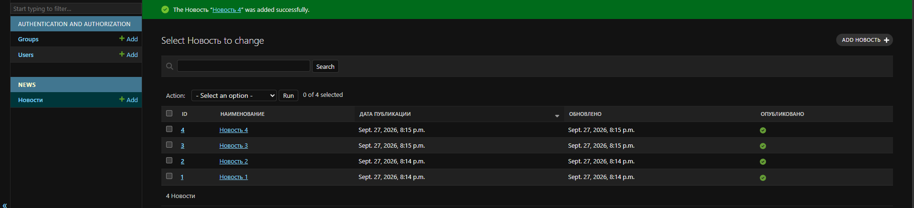

---

### 7. Настройка русского языка

В файле `settings.py` параметр `LANGUAGE_CODE` изменён с `'en-us'` на `'ru'`.

**Скриншот 8 — `settings.py` со строкой `LANGUAGE_CODE = 'ru'`:**

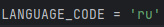

**Скриншот 9 — админка на русском языке (даты в русском формате):**

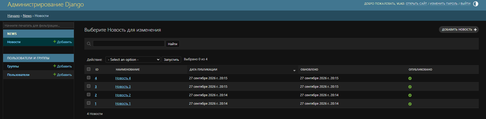

---

### 8. Переименование приложения

В файле `news/apps.py` добавлен атрибут `verbose_name = 'Новости'` для отображения русского названия приложения в админке.

**Скриншот 10 — `apps.py` с `verbose_name`:**

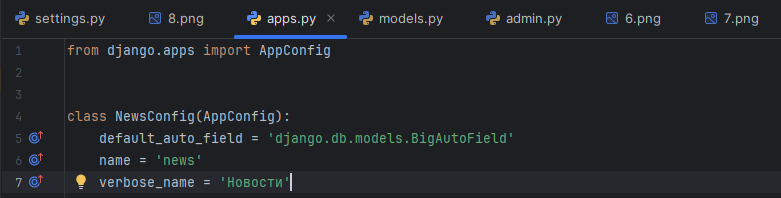

**Скриншот 11 — админка с разделом «НОВОСТИ»:**

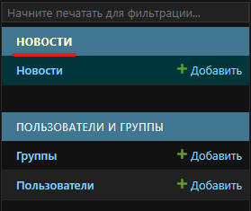

---

### 9. Контроллер с HttpResponse (плохой вариант)

В файле `news/views.py` создан контроллер `index`, который формирует ответ путём склейки HTML-строк. Это демонстрирует неудобство такого подхода.

**Скриншот 12 — `views.py` с функцией `index` через `HttpResponse`:**

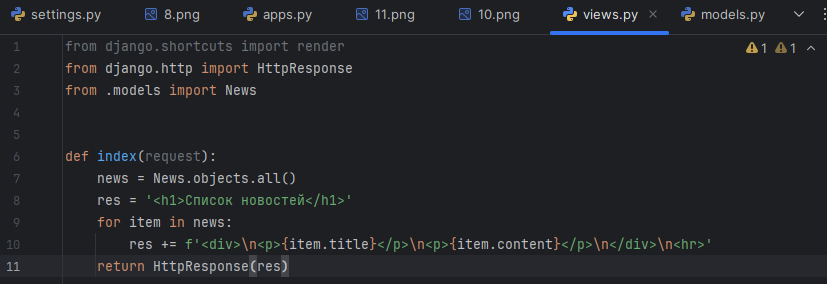

---

### 10. Настройка URL-ов

Создан файл `news/urls.py` и подключён в `MySite/urls.py`.

**Скриншот 13 — файлы `urls.py`:**

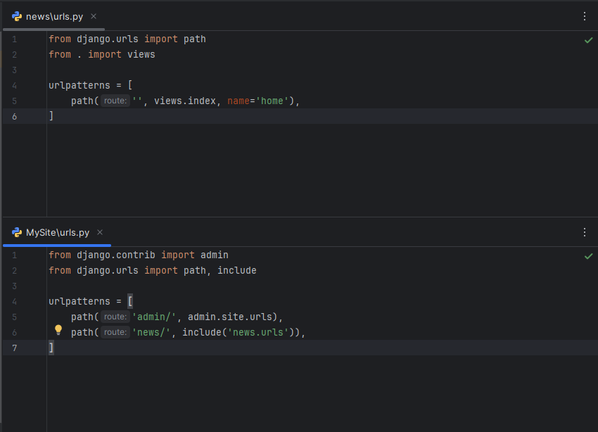

**Скриншот 14 — браузер с «сырым» списком на `/news/`:**

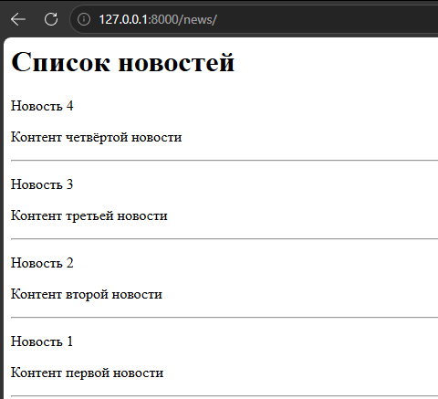

---

### 11. Создание папки templates

Внутри приложения `news` создана папка `templates/news/` для хранения шаблонов.

**Скриншот 15 — дерево проекта с папкой `templates/news/`:**

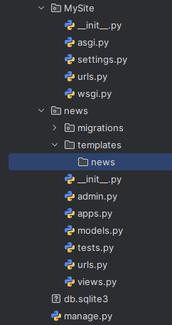

---

### 12. Создание шаблона index.html

Создан шаблон `news/templates/news/index.html`, в котором используются директивы (`{{ title }}`, `{{ item.title }}`), тег `` и фильтр `|date:"Y-m-d H:i:s"`.

**Скриншот 16 — файл `index.html` с шаблоном:**

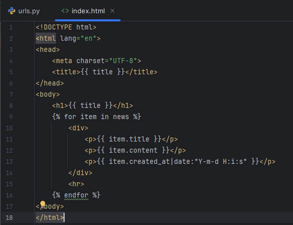

---

### 13. Контроллер с render()

Контроллер `index` переписан с использованием функции `render()`, которая принимает `request`, имя шаблона и контекст (словарь с данными).

**Скриншот 17 — `views.py` с `render()` и `context`:**

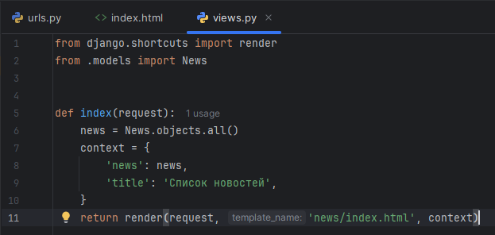

---

### 14. Финальная проверка

Открыта страница `http://127.0.0.1:8000/news/` — данные из модели успешно выведены через шаблон.

**Скриншот 18 — финальная страница «Список новостей»:**

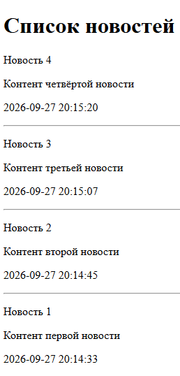

---

## Вывод

В ходе лабораторной работы были изучены шаблоны Django и механизм рендеринга. Освоены директивы (`{{ }}`), теги (``) и фильтры (`|date`) шаблонизатора. Настроена встроенная административная панель Django: зарегистрирована модель `News`, настроены отображаемые поля, поиск, сортировка и русские названия. Данные из модели успешно выведены в браузер через шаблон `index.html` с использованием функции `render()` и контекста. Получены практические навыки работы с админкой Django и шаблонизатором.